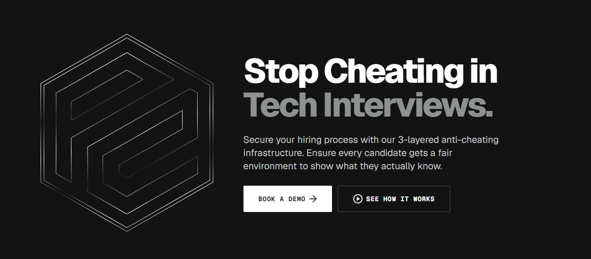

  

# Poperrors

**Stop cheating in tech interviews.**

Poperrors secures your hiring process with a 3-layered anti-cheating infrastructure — browser secure mode, AI proctoring, and actionable integrity reports — so every candidate gets a fair environment to show what they actually know.

## What we build

- **Browser secure mode** — keeps assessments inside a controlled exam environment that discourages unauthorized tools and app switching.
- **AI proctoring** — monitors exam sessions and flags suspicious behavior for review.
- **Integrity reports** — turns session signals into clear, actionable reports for hiring teams.

## Pop Errors Exam Client

The Windows desktop client is available from the [Releases](https://github.com/poperrors/poperrors-desktop/releases/latest) page.

## Links

- **Website:** [poperrors.com](https://poperrors.com)
- **Desktop releases:** [poperrors-desktop](https://github.com/poperrors/poperrors-desktop/releases)
- **Book a demo:** [poperrors.com](https://poperrors.com)
